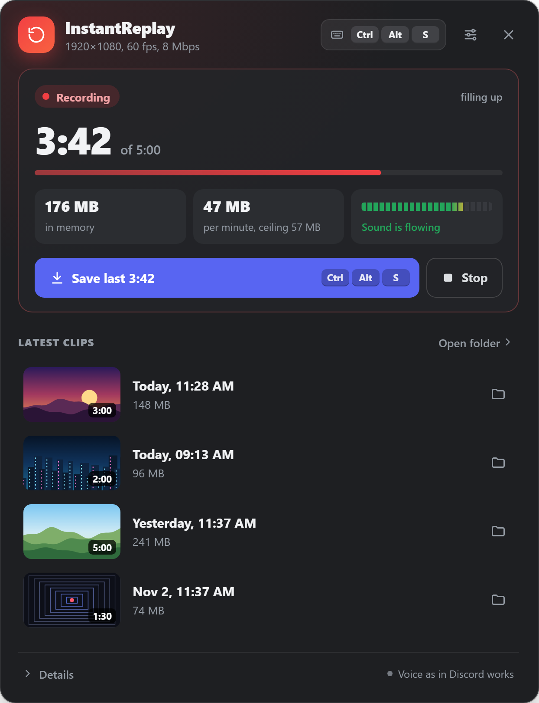
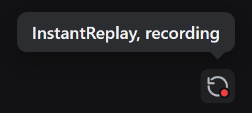

# InstantReplay-Discord

Vencord plugin. Rolling screen buffer inside Discord. Press the hotkey, the last minutes of your screen land in a file.





## Why

ShadowPlay records what the NVIDIA GPU drew. On a hybrid laptop the desktop is composed by the
integrated GPU, so NVIDIA App reports no capture target and refuses to save outside games. This
asks the Windows compositor for the picture instead, so which GPU drew the frame never comes up.

## How it works

One recording, held in memory as a ring of MP4 fragments. Old fragments are dropped, the file
header is kept, and a clip is that header plus whatever is still held. Saving closes the recording
first, so the last second before the press is in the clip, then opens a new one.

The recorder never touches the capture directly. It holds a video track of its own, and the capture
underneath can be swapped while recording: unplugged monitor, changed headphones, a game switching
resolution. None of it costs the buffer.

That track is a frame relay (`MediaStreamTrackProcessor` into `MediaStreamTrackGenerator`): capture
frames go into it as they are, with no copy, no GPU round trip and no drawing on the page's main
thread. When the picture stands still, the last frame is repeated twice a second so the recording keeps
its sense of time. The relay runs in a Web Worker, so frames do not wait on Discord's main thread:
with that thread busy 30% of the time, the relay on the page lost 18% of the frames, in the worker one
in 215. If the worker cannot start, the same code runs on the page. Where the relay is missing or never
gets a frame, the recording takes the capture track directly, and then a change of frame size restarts
the buffer.

Audio goes through a Web Audio mixer fixed at 48 kHz. The Windows AAC encoder takes only 44.1 and 48,
while the output device can sit at anything, and a Bluetooth headset drops to 16 kHz the moment you join
a voice channel.

Chromium leaves `mvhd.duration` at zero when it streams a fragmented MP4, so players show 0:00 and
refuse to seek. The real length is read back from the last fragment's `tfdt` and `trun` and written
into the header in place. That parsing lives in `mp4.ts`, apart from Electron.

## Settings

| | |
|---|---|
| Buffer | How much to keep, 30 s to 10 min. Lives in memory, the window shows the current cost |
| Resolution, frame rate, bitrate | Drop resolution first if the client stutters |
| Source | The whole screen or the Discord window, plus which monitor |
| Capture audio | System mix, through a Web Audio mixer |
| Your voice | `As in Discord` (default) opens the mic only while Discord transmits you, by voice activity or push to talk, with Discord's input volume and processing, and keeps it silent while muted or outside a call. Krisp has no stand-in beyond plain noise suppression, and the voice runs 0.15 s behind so the gate never clips the first syllable. If a Discord update takes away the stores the gate listens to, the window says so and the whole microphone is recorded instead. `The whole microphone` records it all the time, `Do not record` leaves it out. The mic is the one chosen in Discord |
| Mode | `Only while in a voice channel` (default) or `Always, from launch` |
| Grace | How long the buffer survives after leaving a channel |
| Chime volume | Plays the moment a clip is captured, over a fullscreen game too. Zero turns it off |
| Notification | Announces each saved clip, with or without its sound |
| Hotkey | Default `Ctrl+Alt+S`, also changed from the window |
| Global hotkey | Claims it system wide so it fires with Discord in the tray |
| Language | English and Russian, auto follows Discord |

Clips go to `Videos\Discord Replay`.

## Install

Needs a [Vencord dev install](https://docs.vencord.dev/installing/). From the root of that checkout:

```bash
git clone https://github.com/MrTopQ/InstantReplay-Discord src/userplugins/InstantReplay-Discord
```

```bash
pnpm build && pnpm inject
```

`pnpm inject` only the first time. Close Discord fully and start it again, a page reload does not
load the plugin's main process part. Then enable **InstantReplay** in Vencord settings.

## The window

The title bar button opens the plugin's own window, drawn in a separate React root instead of a Discord
modal, so it opens in a few tens of milliseconds. It shows the buffer state, how much is held out of the
window, memory and the real cost per minute, a live meter of the sound going into the recording, the
latest clips with a frame taken at the moment of the save, and the technical details behind a toggle.
The header changes the hotkey: click it and press the combination. Next to the details a small check
says whether `As in Discord` still sees your voice.

The frame comes from the relay, so without the relay a clip has no picture. Thumbnails live in a hidden
`.thumbs` folder next to the clips and disappear with their clip.

## Limits

- Windows only.
- Recording costs 0.6 to 0.9 of one CPU core on a Ryzen 5 5600H at 1600x900 and 45 fps, spread over
  Discord's processes: the screen capture in the browser process, handing frames to the encoder in the
  GPU process, the recorder and the relay in the renderer. The encoding itself runs on the video card.
  Chromium picks the hardware encoder by itself, on an RTX 2050 it took 5 to 7% of the NVENC block.
  Sound is about 0.07 of a core, the relay about 0.03, the plugin's own code well under 1% of the main
  thread. 1280x720 at 30 fps saves about 0.1 of a core.
- Loopback takes the whole system mix. Discord cannot be separated from the rest of it.
- The title bar button rides on one patch of Discord. If a client update breaks it, the icon
  disappears and nothing else does: saving stays on the hotkey, the toolbox and the settings panel.
